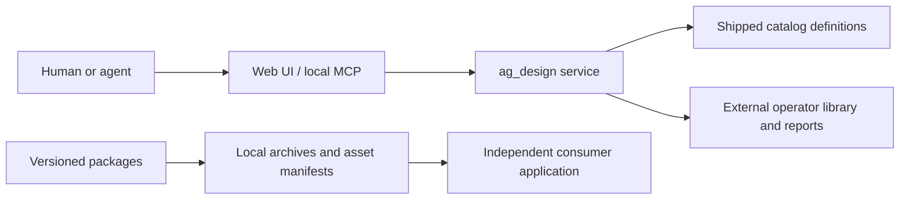

# Architecture

[Русский](Architecture-ru.md) · [Home](Home.md)

`ag_design/` owns HTTP/MCP contracts, catalogue discovery, optional local search and bounded review data. `web/` renders the catalogue, book, sandbox and examples. `catalog/` supplies clean starter definitions; the editable operator library and runtime databases live outside the checkout.

`packages/components` owns reusable geometry, semantics, states and lifecycle helpers. `packages/rules` supplies offline knowledge, grids and audit contracts. `visual-tools` and `interaction-tools` are separate libraries. The consumer owns its palette, data, routing, authorization and transport.

Use exact local archives or vendored assets with hashes. A consumer must not import a sibling source checkout at runtime. A draft definition, a geometric score or a registered usage count is not proof of accessibility or host readiness.
